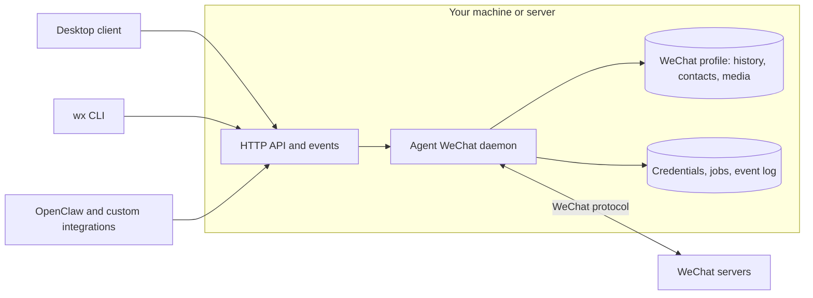

# Agent WeChat

**An open source WeChat client for people and AI agents.**

Use an alternative WeChat desktop client, work from the terminal, or connect your
AI agent. Read your conversations, exchange media, and build your own tools on the
same API. Agent WeChat communicates directly with WeChat; its daemon does not
need the official app running.

[Get started](#get-started) · [Documentation](https://thisnick.github.io/agent-wechat/) · [OpenClaw](#openclaw) · [Downloads](https://github.com/thisnick/agent-wechat/releases)

## See it in action

https://github.com/user-attachments/assets/969f95ef-c17a-4e22-bda0-ec9e08af4ad3

[Watch the 93-second demo](https://www.youtube.com/watch?v=T5LgL4n1MOQ) ·
[Download the video](docs/public/demo/agent-wechat-demo.mp4)

One conversation with Nick Bot: a question from the phone, a voice reply, an image
request in the desktop client, and saving the result from the terminal. The
recording shows the build used for this demo; current setup and platform status
are linked below.

### A desktop interface


### Your WeChat, from the terminal


## Get started

### Desktop app

1. Download the installer for your platform from [GitHub Releases](https://github.com/thisnick/agent-wechat/releases).
2. Choose **Use this device** to run a local hub, or **Connect to another hub**.
3. Add a WeChat profile and follow the sign-in instructions on your phone.

The app includes the chat interface, native hub, and `wx` CLI. See the
[desktop guide](https://thisnick.github.io/agent-wechat/setup/desktop/) for
installers, system requirements, connection keys, and networking. Desktop
packaging and installed-app acceptance vary by platform; check the
[platform status](PLATFORM-ACCEPTANCE.md) and release notes for the build you use.

### Terminal and API

Install the native CLI with npm, then start its daemon:

```bash
npm install -g @agent-wechat/cli
wx --json version
wx serve
```

Allow the package's install script so it can download and verify the native
executable. [Installation alternatives](https://thisnick.github.io/agent-wechat/setup/install/)
include pnpm, standalone binaries, and Docker. Install FFmpeg and FFprobe on the
daemon host for voice/video preparation; the desktop app bundles them.

For an existing supported **WeChat for Linux** profile, close the official app,
back up its files, and run in a second terminal:

```bash
wx auth login --official
wx accounts list
wx chats list
wx messages list filehelper --limit 5
```

Keep the official app closed while the daemon uses that profile. To create a
separate profile instead, see [Connect your account](https://thisnick.github.io/agent-wechat/setup/connect/).
A new profile does not receive your complete old chat history. With several
accounts, select one using `--account ID_OR_ALIAS`.

Once connected, inspect a conversation and save an attachment:

```bash
wx contacts find Alice
wx messages list CHAT_ID --limit 20
wx messages media CHAT_ID MESSAGE_ID --output ./saved-image.jpg
```

See [CLI examples](https://thisnick.github.io/agent-wechat/use/cli/),
[API documentation](https://thisnick.github.io/agent-wechat/use/api/), and
[hosting options](https://thisnick.github.io/agent-wechat/setup/run/).

## WeChat features

| Area | What you can do |
| --- | --- |
| Conversations | Use DMs and groups; browse and search locally stored history; read unread counts and mark chats read. |
| Messages | Send and receive text, images, videos, files, and voice notes; recall eligible own messages and display incoming recalls. |
| Images and video | Preview and download available quality variants, including original images/video; send normal or original-quality video. |
| Voice | Play received notes and send audio as native voice notes. Longer audio can split into multiple notes; playback validation for longer notes remains incomplete. |
| Rich content | Read embedded quotes, link-card metadata, and forwarded conversations. Forwarded bundles become text; their nested attachments remain placeholders. |
| Stickers | Retrieve supported ordinary/shared stickers, including animated originals. Sending stickers and managing packs are unsupported. |
| Mentions | Send real member mentions or mention everyone where permitted; inspect incoming mention metadata. |
| Contacts and groups | Find contacts/groups, read member lists and avatars, and refresh saved metadata. |
| Group management | Create/rename/leave groups, add/remove members, set your group display name, clear announcements, and mute notifications, subject to account permissions. Some profile updates remain partial. |
| Organization | Pin/unpin supported chats and mute/unmute ordinary contacts and groups. |
| Media storage | Configure per-account automatic downloads, save verified media, and inspect transfer progress and unavailable-media status. |
| Desktop | Conversation search, media views, quote navigation, mention picker, native file saving, tray behavior, and notifications. See platform acceptance status above. |
| Automation | Use the `wx` CLI or authenticated HTTP API; follow replayable events and inspect send/download jobs. |

Outgoing quoted replies and link-card sends are implemented but still await live
recipient validation. Media availability depends on the received source, supported
formats, and size limits. Search covers stored history, not all remote history.
See [message types](https://thisnick.github.io/agent-wechat/how-it-works/message-types/),
[media](https://thisnick.github.io/agent-wechat/use/media/),
[groups](https://thisnick.github.io/agent-wechat/use/groups/), and the
[implementation and validation checklist](packages/native-client-rust/FEATURES.md).

## Use your existing official profile

Agent WeChat can read and continue supported writes in an existing official
WeChat for Linux profile **in place**. It retains the account identity and uses
its stored conversations, contacts, groups, and media.

| Profile data | Read | Write |
| --- | --- | --- |
| Messages | Stored history and supported rich content | Newly received and accepted outgoing messages; supported recall updates |
| Contacts | Saved contact metadata and avatars | Supported metadata received through WeChat sync |
| Groups | Details, rosters, names, and notification settings | Supported synchronized fields and group-operation results; some updates remain partial |
| Media | Supported cached images, video, files, and voice | Supported downloaded/sent cache files and associated resource records |
| Conversation state | Conversations, unread state, supported pin/mute settings | Supported read-state, pinning, and notification updates |
| Saved sign-in | Supported saved account/device information, when WeChat accepts it | Supported accepted sign-in and routing updates |

Offline profile commands can inspect supported stored history, contacts, groups,
and media without a daemon or network connection, using source-preserving
snapshots and the required keys. Contact writes here mean synchronized metadata;
they do not imply arbitrary friend creation, deletion, or editing.

Existing-profile compatibility targets recognized Linux layouts. Unknown files
are preserved and unsupported database layouts are refused. General official
search-index maintenance, arbitrary profile migration, and seamless switching
back to the official app are not established. Copy/import/export workflows remain
experimental. See the [native profile guide](packages/native-client-rust/README.md).

## Codex extension (experimental fork)

This fork adds `packages/codex-extension`, a source-run workspace package for a
local Codex App Server. It reuses the native SDK and daemon without OpenClaw.
Node 24.22.1 or newer and an already authenticated `codex` executable are required.
The native transport remains pinned to upstream v1.4.0; a fresh profile on macOS
still needs real account and group acceptance. No account-safety guarantee is made.
The phone can identify this connection as Linux WeChat because the backend uses
the Linux client identity, even when its executable runs on macOS. The worker
does not automate the official macOS app.

Use a dedicated managed account/profile and an explicit loopback URL. Do not use
`auth login --official`, import an everyday account's profile, or scan its QR with
an account that must stay signed in elsewhere. Create a private JSON config outside
the checkout with these fields:

| Field | Purpose |
| --- | --- |
| `baseUrl` | Explicit local daemon URL, such as `http://127.0.0.1:16174` |
| `accountId`, `ownUsername` | Exact daemon account and authenticated WeChat identity |
| `stateDir` | Absolute private worker directory, separate from the native profile |
| `groups` | Array of `{ id, senders, mode, prefix?, replyToAssistantQuotes? }`; exact ordinary-group IDs and sender IDs only |
| `replyToAssistantQuotes` | Per-group opt-in, false by default. Any member quoting a verified assistant message in this group triggers a reply, without prefix or ordinary chatter quota/silence gates |
| `mode` | Per-group `prefix` requires the configured text prefix; `selective` answers concrete questions, explicit requests or related follow-ups without an @mention, and defaults to silence for small talk/statements |
| `sendEnabled` | Defaults to false; explicitly enable only for the selected test group |
| `disabledMcp` | All configured and host-injected MCP server names; startup refuses tools that remain available |
| `cooldownMs` | Minimum interval between accepted replies per group; defaults to 10000, 0 disables this cooldown |
| `callIntervalMs` | Minimum interval between model calls per group, including silent/failed calls; defaults to 30000, 0 disables this interval |
| `maxCallsPerHour` | Maximum model calls per group in a rolling hour; defaults to 6, minimum 1 |
| `batchWindowMs` | Collect consecutive messages until this much silence; defaults to 3000, 0 disables merging |
| `batchMaxWaitMs` | Maximum collection time despite continuous traffic; defaults to 10000 |
| `batchMaxMessages` | Maximum messages in one batch; defaults to 12, with an additional 8000-character input bound |
| `pollIntervalMs` | Local event polling interval; defaults to 1000, range 100–10000 |
| `codexBinary`, `model` | Optional executable/model overrides; omitted model uses the existing Codex default |
| `codexHome` | Absolute dedicated Codex configuration directory; authenticate it through official Codex login with the keyring credential store |
| `persistentConversations` | Defaults to false. With user consent, keep one Codex thread per group; requires `codexHome` |

After `pnpm --filter @agent-wechat/codex-extension... install --ignore-scripts`,
run the source CLI (no Rust or TypeScript build is required):

```bash
node packages/codex-extension/src/cli.mjs doctor /absolute/private/config.json
node packages/codex-extension/src/cli.mjs codex-test /absolute/private/config.json
node packages/codex-extension/src/cli.mjs run /absolute/private/config.json
node packages/codex-extension/src/cli.mjs usage /absolute/private/config.json
node packages/codex-extension/src/cli.mjs context /absolute/private/config.json [groupId]
node packages/codex-extension/src/cli.mjs debug /absolute/private/config.json [port]
```

Supply `AGENT_WECHAT_TOKEN` from the local credential store privately at launch;
do not put it in the JSON config or commit it. `doctor` is read-only. `codex-test`
checks model handoff without sending to WeChat. Worker logs contain status events,
not message bodies. Start with `sendEnabled: false`, then confirm the exact group,
sender and test message before enabling live replies.
An internal timeout from the read-only Codex account preflight is retried at most
twice using the same process and login. Authentication rejections and WeChat send
submissions are not retried.
Before QR login, `doctor` and `codex-test` also accept an unconfigured identity
with `groups: []`; `run` always requires the pinned identity and explicit groups.
`usage` reads the private journal without a daemon token, model call or worker lock.
Configuration is read at startup; restart only this worker after changing limits
or group policies.

The group worker uses short chat instructions and disables development environment,
permissions, collaboration, memory and skill prompt injection in its own process.
Use a dedicated `codexHome` so global development instruction files are not loaded;
the worker refuses inference if Codex still reports instruction-file sources.
Authenticate that directory separately with official Codex login and the keyring
credential store; do not copy authentication files. Everyday Codex configuration
and login remain unchanged. An omitted model uses this isolated profile's default,
so set `model` when keeping an existing model across the migration.
When `model` is configured, the assistant receives that identifier as caller-provided
metadata and can state it when asked. This reports the integration's configuration;
it is not independent verification of the underlying model version. An omitted
identifier is not guessed. The prompt inspector shows this configured identity too.

The worker merges admitted incoming messages from the same group before model
dispatch, retaining their order and sender IDs. It does not interrupt a generation
already in progress; messages arriving during inference wait for the next poll and
batch. Other groups cannot join; unapproved senders are ignored except for the
explicit verified-assistant-quote route described below. Each whole batch
consumes one model-call reservation, saved before dispatch. The interval/hour limits
apply to ordinary admitted senders and trigger modes; verified assistant quotes
use the explicit exception below. Rate-limited batches are discarded,
not delayed until their quota resets. Silent, failed and dry-run calls still count;
the interval and rolling-hour timestamps survive worker restarts.

With `replyToAssistantQuotes: true`, received WeChat quote replies (type 49,
subtype 57) are admitted in that configured group. A quote of the assistant is
verified against the canonical same-account/chat history before generation and
again before sending, using at most 100 pages of 200 messages. The model receives
the excerpt embedded in the quote, never a substituted original. An available,
verified assistant quote is an explicit request from any group member, bypassing
the sender/prefix and ordinary hourly/interval/cooldown gates while still counting
all model usage. A silent model decision gets a short clarification reply. Missing,
recalled or unverifiable originals cannot open this route. Other authors' quotes
still follow the configured sender and normal reply policy. Bound text inputs and
same-group send recovery still apply; network/model failures remain failures.
This adds received-quote handling; the assistant's outgoing replies remain plain
text and do not claim live validation of native quoted sends.

Per-group usage records admitted/merged messages, calls, silent/failed/unknown calls,
rate-limited batches and accepted replies. Token counts come from Codex's
`thread/tokenUsage/updated` snapshots, not model-generated JSON or character estimates.
`reportedTokens` sums only reported usage; `unknownUsageCalls` and
`tokenUsageComplete` identify missing or interrupted measurements. Cached input is
already included in input tokens, and reasoning in output tokens; neither is added
twice to the reported total. Counts include Codex instructions/context, not just
WeChat message text. No currency estimate or hard token-spending cap is provided.
Persistent, tool-free turns use the notification's `last` request usage, so previous
turn totals are not counted again. Repeated context can still contribute input
tokens; cached input remains part of the reported input count.
Statistics start when the v2 journal is initialized; old calls are not backfilled,
and standalone `codex-test` calls are not assigned to a group.

The v1 journal upgrade preserves existing cursors and send receipts. An inference
left in `generating` after a crash is marked unknown and never automatically
regenerated; its call reservation remains consumed. A crash can leave actual token
usage unknown. Pending batch metadata contains message references and fingerprints,
not copies of settled chat text. Do not restore an older journal over later sends.

Only fresh committed incoming text is eligible; self messages, catch-up/imports,
old messages, recalls and other groups are ignored. Sender exceptions require the
opt-in verified-assistant-quote route. In the default temporary
mode, history is fetched from the native store, with at most 12 messages from
admitted senders. With `persistentConversations`, each group keeps one separate
Codex thread and appends only newly admitted batches; earlier temporary calls and
unadmitted group traffic are not imported. Codex retains the assistant interactions,
including silent decisions. Long histories may be compacted by Codex; stored history
does not guarantee every old message remains verbatim in model context.

The v3 sidecar preserves existing quotas, cursors and send receipts and adds only
group-to-thread/profile bindings and message reference metadata. Canonical chat
history stays in Codex. `context` reads its paginated history without a model turn,
daemon token or worker lock, and writes a private Markdown viewing file. Omit the
group ID only when exactly one group is configured. The worker refreshes this same
view after each completed generation. It contains supplied chat instructions, user
inputs and final decisions, excluding hidden reasoning and server instructions;
send acceptance remains a separate receipt. Editing the view does not change model
memory. Open the returned file in the desktop app's right panel. Isolated-profile
threads are not assumed to appear in the everyday app sidebar.

For a chat-style debugging view, run `debug` and open `http://127.0.0.1:16175`.
An optional port overrides 16175. This separate read-only process shows each
configured group's persisted conversation, searchable messages, raw user inputs
and final output, configured prompts, cumulative group usage, limits and recent
send receipts. It refreshes every five seconds while the page is visible. Usage
and old task receipts can predate the current thread. New tasks separately record
time waiting before the model, the model call, and local observation of an accepted
send. Total latency starts at local message observation, not the phone's send time;
old tasks without these measurements show unknown. Shorter batch/poll windows can
reduce local waiting; model processing and network time remain variable. Set both
`callIntervalMs` and `cooldownMs` to 0 to permit prompt follow-ups; hourly limits and
same-group send recovery still apply.
It reads existing Codex history through the authenticated local App Server without
a model turn, daemon token, worker lock or additional chat archive. The endpoint binds only
to IPv4 loopback, rejects cross-origin access and provides no send/edit controls.
It does not expose hidden reasoning or platform instructions. Stop with Ctrl-C;
the chat worker and WeChat connection remain independent.

Sends have stable keys; uncertain submissions are inspected, never blindly retried.
An unresolved receipt holds subsequent replies in that group. A worker lock
refuses concurrent owners; after an unclean exit, verify the recorded PID has
stopped before removing only that worker's stale `worker.lock`.

Codex runs with read-only sandbox, no approvals, empty execution environments,
disabled shell/Apps/web/skills and no external MCP tools. Knowledge-base access,
media, direct messages, group management and unattended service installation are
outside this initial extension. The package is private and workspace-only; it is
not published to npm.

## OpenClaw

Connect an agent to WeChat with the `@agent-wechat/agent-wechat` plugin:

```bash
openclaw plugins install @agent-wechat/agent-wechat
```

Then follow [OpenClaw setup](https://thisnick.github.io/agent-wechat/openclaw/setup/)
to select the account, create a scoped token, and configure who the agent answers.
DMs and groups are disabled until configured. Replies use the connected account.

| Feature | Support |
| --- | --- |
| DMs and groups | Receive allowed messages and reply in the same WeChat thread. |
| Multimodal input | Images for compatible vision models; local file/video/voice attachments; voice transcription through OpenClaw's configured runtime. |
| Multimodal output | Text, images, videos, files, and native voice notes. Ordinary audio can remain a file. |
| Group context and mentions | Per-group behavior, real @mention gating, permitted unmentioned messages as context, and outgoing member/everyone mentions. |
| Access policies | Separate DM/group policies, sender allowlists, and per-group overrides. |
| Current-chat tools | `wechat_history`, `wechat_search`, `wechat_message`, and `wechat_media` for stored history and verified attachment retrieval. |
| Optional archive access | `wechat_archive_*` tools can list/search/read all chats in the configured account when granted by agent tool policy. |
| Message actions | `wechat_recall`; quoted replies through `message.replyTo` and link cards through `wechat_send_share` have the live-validation limits noted above. |
| Login assistance | `wechat_login` can inspect status, show a login QR, wait for approval, disconnect, log out, or explicitly forget local authentication. |
| Group information | `wechat_group_info` provides owner/admin-authorized cached group/member reads. Group mutation tools are not exposed. |
| Read behavior | Mark chats read after inbound handling, after confirmed model dispatch, or never. This acts on the whole chat through its read boundary. |
| Hosting and recovery | External or plugin-managed daemon; retained event progress across restarts; uncertain sends reported for review rather than blindly resent. |

Default history/media tools stay within the current chat. Archive grants allow
account-wide reads, including from other channels, so grant them only to agents
that should have that access. Media understanding and generation depend on your
configured models and tools. See [agent tools](https://thisnick.github.io/agent-wechat/openclaw/tools/),
[access policies](https://thisnick.github.io/agent-wechat/openclaw/access/), and
[hosting modes](https://thisnick.github.io/agent-wechat/openclaw/modes/).

## How it works



The Rust daemon handles accounts, synchronization, and media. Clients share an
authenticated API and event stream. Supported message/contact/group state lives
in the WeChat profile; the daemon keeps its credentials, pending work, and
recovery records separately. One writer owns each profile.

The same API used by the desktop app, CLI, and OpenClaw is available for your own
scripts, integrations, and clients. Read the
[architecture guide](https://thisnick.github.io/agent-wechat/how-it-works/architecture/)
for the component boundaries and storage model.

Upgrading an older installation? Follow the [migration guide](https://thisnick.github.io/agent-wechat/setup/migrate/) and retain your profiles and backups.

## Explore and contribute

Try the client with synthetic accounts and media, without connecting to WeChat:

```bash
pnpm install --frozen-lockfile
pnpm client:dev
```

See the [client preview guide](packages/client-ui/README.md) and
[simulator guide](packages/native-client-rust/crates/wechat-simulator/README.md)
for prerequisites and scenario controls. To build and test changes, start with
[AGENTS.md](AGENTS.md) and the
[build guide](https://thisnick.github.io/agent-wechat/reference/build/).

The [demo assets and gallery source](scripts/demo-gallery/README.md) include the
finished video, screenshots, synthetic visual fixtures, and image-generation
scripts. [Video edit sources](scripts/demo-video/README.md) preserve the motion
titles, timing, and original instrumental; private raw recordings stay outside Git.

## License

Agent WeChat's original project code is licensed under the [MIT License](LICENSE).
Third-party components retain their existing licenses and notices; see the
[bundled notices](packages/cli/THIRD_PARTY_NOTICES.txt), component-specific notices,
and the [Inter font license](scripts/demo-video/fonts/OFL.txt).
